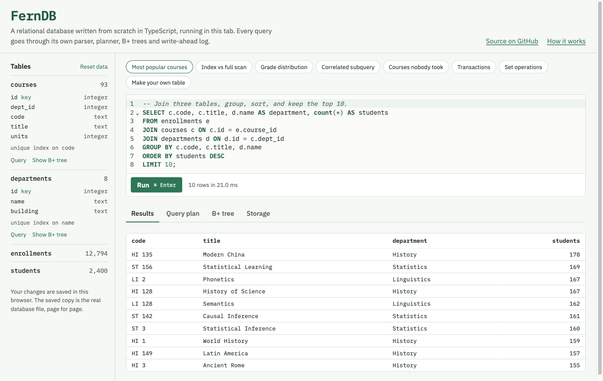
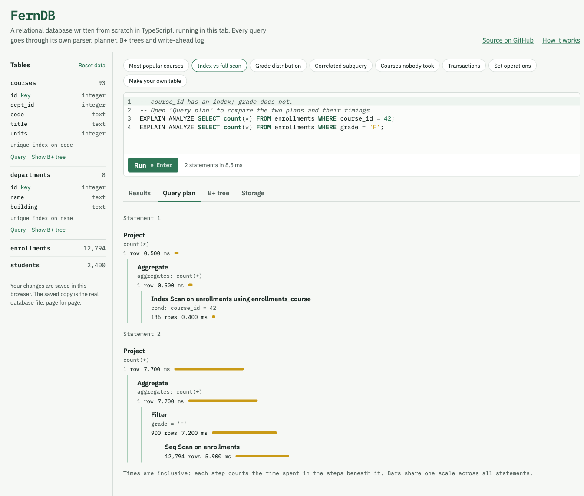
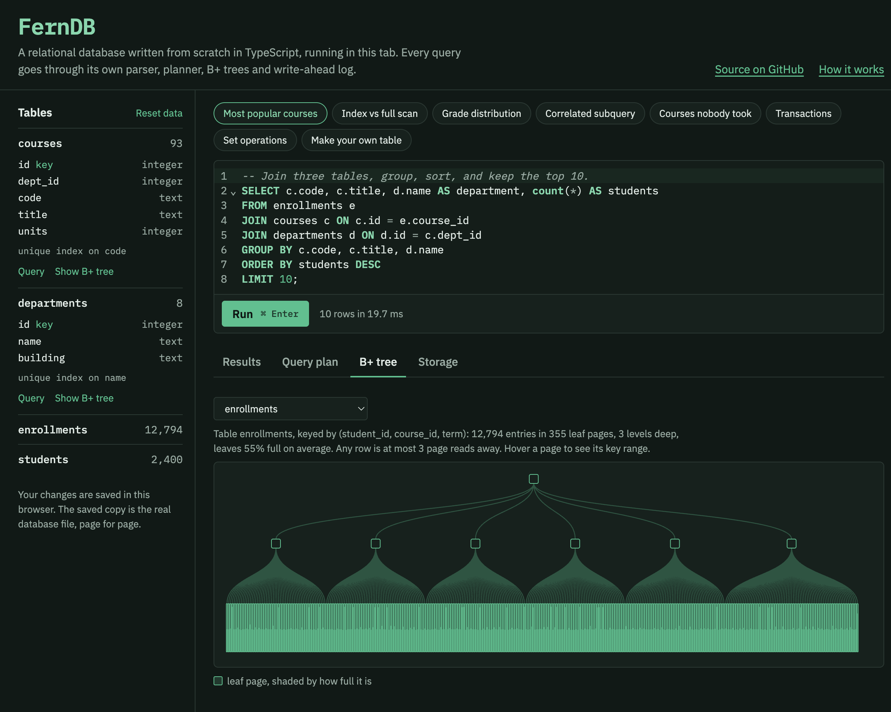
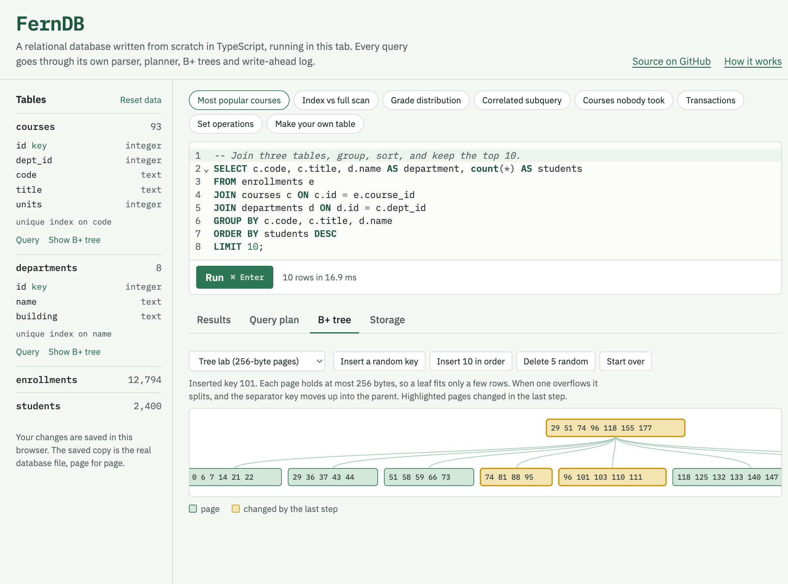

# FernDB

A relational database built from scratch in TypeScript, with no runtime dependencies: a SQL parser, a cost-based query planner, paged B+ trees, a buffer pool and a crash-safe write-ahead log.

**[Try it in your browser](https://atharv146.github.io/ferndb/)**: run SQL against a sample university database, read the executed plan for any query, and watch B+ tree pages split as you insert keys.



<table>
  <tr>
    <td width="50%"></td>
    <td width="50%"></td>
  </tr>
  <tr>
    <td>Executed plans with per-operator row counts and timings. Here the index scan beats the full scan.</td>
    <td>A table's B+ tree, drawn from its real pages, with each leaf shaded by how full it is.</td>
  </tr>
</table>



```
$ node src/cli.ts shop.fern   # data from bench/readme-example.ts
ferndb> EXPLAIN ANALYZE
   ...> SELECT c.name, count(*) AS orders, sum(o.total) AS spent
   ...> FROM customers c JOIN orders o ON o.customer_id = c.id
   ...> WHERE c.city = 'Fremont'
   ...> GROUP BY c.name ORDER BY spent DESC LIMIT 5;
Limit  (rows=5 loops=1 time=1.485ms)
│  limit 5
└─ Top-N Sort  (rows=5 loops=1 time=1.455ms)
   │  key: spent DESC
   └─ Project  (rows=31 loops=1 time=1.303ms)
      │  name, orders, spent
      └─ Hash Aggregate  (rows=31 loops=1 time=1.247ms)
         │  group by: c.name
         │  aggregates: count(*), sum(o.total)
         └─ Index Nested Loop Join  (rows=311 loops=1 time=1.015ms)
            │  probe orders o using orders_customer: o.customer_id = c.id
            │  est. cost: probe 240 vs hash 4040
            └─ Index Scan on customers c using customers_city  (rows=32 loops=1 time=0.251ms)
                  cond: c.city = 'Fremont'
Planning time: 1.102 ms
Execution time: 1.517 ms
Rows returned: 5
```

## What's inside

| Layer | What it does | Code |
|---|---|---|
| SQL front end | Hand-written lexer and recursive-descent parser with precise error positions | [`src/sql`](src/sql) |
| Planner | Predicate pushdown; index selection over equality, range, `BETWEEN` and `IN`; a cost-based choice between index nested-loop, hash and nested-loop joins; sort elimination and top-N | [`src/planner`](src/planner/planner.ts) |
| Executor | Volcano-style pull iterators; expressions compiled to closures; full SQL three-valued `NULL` logic; correlated subqueries | [`src/exec`](src/exec) |
| B+ trees | Byte-size splits, overflow pages, merge on delete, stable root pages, re-seekable cursors | [`src/storage/btree.ts`](src/storage/btree.ts) |
| Key encoding | Order-preserving ("memcomparable") encoding, so composite keys and index scans are plain byte ranges | [`src/encoding/keycodec.ts`](src/encoding/keycodec.ts) |
| Pager | CLOCK buffer pool, NO-STEAL transactions, checksummed write-ahead log, checkpoints, crash recovery | [`src/storage/pager.ts`](src/storage/pager.ts) |

**SQL support:** `CREATE`/`DROP TABLE` and `INDEX` (unique and composite); `INSERT ... VALUES` and `INSERT ... SELECT`; `UPDATE`; `DELETE`; `SELECT` with `INNER`/`LEFT`/`CROSS JOIN`, `USING`, `WHERE`, `GROUP BY`, `HAVING`, `DISTINCT`, `ORDER BY`, `LIMIT`/`OFFSET`; `UNION [ALL]`/`INTERSECT`/`EXCEPT`; scalar, `IN`, `EXISTS` and correlated subqueries and derived tables; `CASE`, `CAST`, `LIKE`/`ILIKE`, `BETWEEN`; aggregates including `count(DISTINCT ...)` and `string_agg`; about 25 scalar functions; `PRIMARY KEY` (including composite), `UNIQUE`, `NOT NULL`, `DEFAULT`; `BEGIN`/`COMMIT`/`ROLLBACK` (DDL included); `EXPLAIN [ANALYZE]`; `?` parameters.

[`docs/ARCHITECTURE.md`](docs/ARCHITECTURE.md) walks through each layer in detail.

## How I know it's correct

- **Crash consistency, tested at every write.** The test suite simulates a power cut after each individual disk write of a multi-transaction workload, sometimes tearing the last page in half. It reopens the database every time and checks that recovery lands on exactly some committed prefix of the transactions. It also crashes during recovery itself and corrupts log bytes on purpose. ([`tests/crash.test.ts`](tests/crash.test.ts))
- **Differential fuzzing against SQLite.** A seeded generator produces random tables, indexes, joins, aggregates, NULL-heavy predicates, updates and deletes. Both FernDB and SQLite run them, and every result must match row for row. A long run has matched on about 480,000 statements. It also caught a real bug: auto-assigned ids went stale after deletes. ([`tests/fuzz/differential.ts`](tests/fuzz/differential.ts))
- **Property-based tests** check the B+ tree against a sorted-map model under random inserts, updates and deletes on tiny 256-byte pages, and check that the key encoding preserves order. ([`tests/btree.test.ts`](tests/btree.test.ts), [`tests/encoding.test.ts`](tests/encoding.test.ts))
- **269 SQL logic test records**, including assertions about which plan the optimizer picks. ([`tests/sql`](tests/sql))
- **`checkIntegrity()`** verifies every tree invariant and that each index matches its table exactly.

```bash
npm test             # unit, SQL, crash and fuzz tests
npm run fuzz -- 5000 # longer differential fuzzing run against SQLite
```

## Performance

`npm run bench` on an M-series MacBook (Node 26), with 100,000 rows per table. SQLite is the C library bundled with Node, configured for the same durability as FernDB (`synchronous=FULL`, `fullfsync`). FernDB is not trying to beat it; the comparison is there for scale.

| Benchmark | FernDB | SQLite |
|---|---:|---:|
| Bulk insert, 100,000 rows in one transaction | 795 ms (126k rows/s) | 136 ms |
| 500 single-row transactions, each fsynced | 1,992 ms (251/s) | 1,810 ms (276/s) |
| 50,000 primary-key lookups | 754 ms (66k/s) | 349 ms |
| 200 lookups on an unindexed column | 7,358 ms | 1,535 ms |
| The same 200 lookups after `CREATE INDEX` | **12 ms** (about 600× faster) | 1.2 ms |
| Three-way join with `GROUP BY` | 482 ms | 115 ms |
| `ORDER BY ... LIMIT 10` over 100k rows (top-N heap) | 25 ms | 4 ms |

Profiling drove the main optimizations:
- Replacing an LRU list with CLOCK eviction made indexed lookups 5× faster.
- Caching B+ tree node sizes stopped every insert from recomputing them.
- Per-tree change tracking stopped scans from re-seeking whenever an unrelated tree changed.
- The cost model switched the large join from probing to hashing, making it 4× faster.

## Use it

Requires Node 22.18 or newer, which runs the TypeScript sources directly.

```bash
git clone https://github.com/atharv146/ferndb && cd ferndb && npm install
node src/cli.ts shop.fern        # interactive shell: .tables .schema .tree <name> .stats .integrity
npm run dev                      # the browser playground at localhost:5173
```

As a library:

```ts
import { openDatabase } from 'ferndb/node';

const db = openDatabase('shop.fern');
db.exec(`CREATE TABLE IF NOT EXISTS items (id INTEGER PRIMARY KEY, name TEXT NOT NULL, price REAL)`);
db.query('INSERT INTO items (name, price) VALUES (?, ?)', ['notebook', 3.5]);
console.log(db.all('SELECT name, price FROM items WHERE price < ?', [10]));
db.close();
```

## Project layout

```
src/
  sql/          lexer, parser, AST, SQL printer
  planner/      access paths, joins, aggregation, ordering
  exec/         expression compiler and physical operators
  storage/      pager + WAL, B+ tree, file backends
  encoding/     key and row encodings, CRC-32
  database.ts   statements, DDL/DML, constraints, transactions
  cli.ts        interactive shell
web/            browser playground (Vite + CodeMirror, hand-drawn SVG)
tests/          unit, SQL logic, crash, property and differential fuzz tests
bench/          benchmarks and the long-running fuzzer
```

## Limits

There is a single writer and no concurrent connections. Numbers are JavaScript doubles. Joins run in `FROM` order, and there is no `ALTER TABLE`, views or window functions. [The architecture doc](docs/ARCHITECTURE.md#known-limitations) has the full list.

## Contributing

Issues and pull requests are welcome; see [CONTRIBUTING.md](CONTRIBUTING.md) for setup and ideas.

## License

MIT
