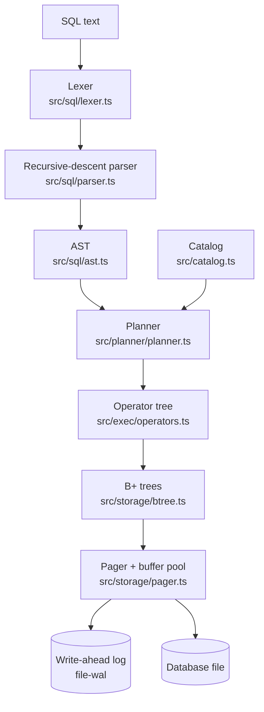

# How FernDB works

This document follows one statement from text to disk and back. File paths point at the code that does each step.



## 1. Parsing

The lexer turns text into tokens and remembers each token's offset, so errors can point at the exact character:

```
expected FROM but found 'FORM' at line 1, column 10
  SELECT a FORM t
           ^
```

The parser is hand-written recursive descent. Expressions use precedence climbing (`OR` < `AND` < `NOT` < comparisons < `||` < `+ -` < `* / %` < unary minus), which is why `a OR b AND c` groups as `a OR (b AND c)`.

## 2. Storage: pages, B+ trees and keys

The file is an array of fixed-size pages (4 KB by default). Page 0 is a header holding the page count, the freelist head and the root of the schema tree. Every table and every index is a **B+ tree**, and so is the catalog itself.

**Keys are bytes.** Before a value goes into a tree it is encoded so that comparing the bytes with `memcmp` gives the same order as comparing the SQL values (`src/encoding/keycodec.ts`). Numbers are stored as big-endian IEEE-754 floats with the sign bit flipped, and text has its zero bytes escaped and a terminator added. Because every encoded value is self-delimiting, a composite key `(a, b)` is just `enc(a) ++ enc(b)`. So one B+ tree implementation serves primary keys, composite keys and indexes, and range and prefix scans are plain byte-range scans. A property test checks the ordering claim on thousands of random tuples.

**Splits are by size, not count.** Rows vary in length, so a node splits when its encoded size passes the page size, at the point where the halves have equal bytes. Every cell is capped at a quarter page, which guarantees both halves fit. Bigger values move to a chain of overflow pages.

**Appends stay dense.** When a key lands at the end of the rightmost leaf, as auto-increment ids do, the split moves only the new key to a fresh page. Bulk loads then fill pages to about 100% instead of 50%.

**Root ids never change.** When the root splits, its contents move to a new page and the root becomes their parent. When it shrinks to a single child, that child moves back up. The catalog can therefore record a tree by its root id forever.

**Deletes merge.** An underfull node merges with a sibling when the two fit on one page, and freed pages go onto a freelist for reuse.

**Cursors re-seek.** A scan is a generator holding a path of (node, index) frames. If the tree changes while the scan is paused, it re-descends from the root to just past the last key it returned. UPDATE and DELETE also collect their target rows before changing anything, which avoids the [Halloween problem](https://en.wikipedia.org/wiki/Halloween_Problem).

## 3. The pager: buffer pool, transactions, durability

The pager (`src/storage/pager.ts`) is the only code that touches files.

**Buffer pool.** Pages are cached in decoded form, so the B+ tree works with plain arrays instead of re-parsing bytes. Eviction uses the CLOCK (second-chance) algorithm: a hit only sets a reference bit. An LRU list would be reordered on every access, and profiling showed that reordering alone cost more than the queries.

**Transactions are NO-STEAL.** A dirty page never leaves memory before commit, so rollback just forgets the dirty pages. Schema changes are rows in the catalog tree, so `CREATE TABLE` and `DROP INDEX` roll back like anything else.

**Commit appends to a write-ahead log.** The full images of the dirty pages are written to `<file>-wal` as frames:

```
frame = pageId | commit marker | salt1 | salt2 | crc32 | page bytes
```

The last frame of a transaction carries the commit marker (the new page count). One `fsync` of the log makes the commit durable, and the main file isn't touched yet. Readers find the newest copy of a page through an in-memory index into the log. Every 1,000 frames, a checkpoint copies those pages into the main file and empties the log.

**Recovery.** On open, the log is replayed frame by frame. Each frame's CRC chains from the previous one and must carry the current salts, so the first torn, corrupt or stale frame ends the replay. Pages are only applied up to the last commit marker before that point. The result is always some prefix of the committed transactions.

**How that is tested** (`tests/crash.test.ts`). A wrapper file "loses power" after N writes, and the final write may be torn in half. The test first counts every write in a multi-transaction workload that includes inserts, updates, overflow pages, DDL and checkpoints. Then, for each N, it crashes there, reopens, and checks that every B+ tree and index is consistent and that the contents equal some committed prefix. It also crashes again *during* recovery, and flips a byte in the log to make sure checksums catch it.

## 4. Planning

`src/planner/planner.ts` turns the AST into a tree of operators.

1. **Name resolution.** Each `FROM` item contributes columns to a scope. Scopes chain outward, so a correlated subquery can see its enclosing query's columns. Ambiguous names are errors.
2. **Predicate pushdown.** `WHERE` is split into `AND`ed conjuncts. A conjunct mentioning one table runs at that table's scan. One mentioning two tables becomes a join condition. `LEFT JOIN` constrains this: a `WHERE` filter on the right side must stay above the join, because it must also see the NULL-extended rows.
3. **Access paths.** For each table, every `col = const`, range, `BETWEEN` and `IN (...)` predicate is matched against the primary key and each index. Equalities must cover a prefix of the key, optionally followed by a range on the next column. Costs: point lookup < prefix scan < range scan < full scan, with secondary indexes slightly penalized for the extra row fetch. Constants may be parameters or columns of an outer query, so a correlated subquery like `WHERE o.customer_id = c.id` probes an index once per outer row.
4. **Joins.** Joins are left-deep, in `FROM` order. Each join chooses between:
   - an **index nested-loop join** (probe the inner table's key for each outer row),
   - a **hash join** (build a hash table on the inner side),
   - a **nested-loop join** for non-equality conditions.

   The choice compares estimated costs from table row counts (tracked incrementally) and textbook selectivities.
5. **Aggregation.** Aggregate calls are gathered from `SELECT`, `HAVING` and `ORDER BY`, computed once in a hash aggregate, and substituted back into those expressions. A column that is neither grouped nor aggregated is an error, as in PostgreSQL.
6. **Ordering.** If the chosen access path already returns rows in `ORDER BY` order, there is no sort; a `DESC` order makes the scan run backwards. With a `LIMIT`, an index may be chosen purely for its order. Otherwise `ORDER BY ... LIMIT n` uses a bounded heap (top-N), which needs O(n) memory instead of sorting everything.

`EXPLAIN` prints the tree. `EXPLAIN ANALYZE` runs it and reports rows, loops and time for every operator.

## 5. Execution

Operators (`src/exec/operators.ts`) are generators, the classic Volcano model: each pulls rows from its children on demand, so `LIMIT 5` stops the table scan after five rows. Expressions are compiled once into closures with column positions already resolved (`src/exec/expr.ts`), and they follow SQL's three-valued logic: `NULL = NULL` is NULL, `NULL AND false` is false, and `x NOT IN (1, NULL)` is never true.

Uncorrelated subqueries run once per statement and are cached. Correlated ones re-run for each outer row, with that row pushed onto an environment stack so inner column references can reach it.

## 6. Checking correctness

- **SQL logic tests** (`tests/sql/*.slt`): 269 statements and expected results covering joins, NULL semantics, aggregates, subqueries, constraints, transactions, index selection and DML. The `plan` records also pin which algorithm the planner picks.
- **Differential fuzzing against SQLite** (`tests/fuzz/differential.ts`): random tables, indexes, queries (joins, `GROUP BY`, `HAVING`, `DISTINCT`, `IN`, `BETWEEN`, arithmetic, `LIMIT`/`OFFSET`) and modifications run on both engines, and every result must match row for row. It found a real bug: auto-assigned ids went stale after deletes. A long run (`npm run fuzz -- 6000`) has matched SQLite on about 480,000 statements.
- **Property tests** (fast-check): the B+ tree against a sorted-map model under random inserts, upserts and deletes on tiny pages, and the key encoding's ordering and round-trip properties.
- **Crash tests**, as described above.
- **`checkIntegrity()`** verifies every tree's invariants (key order, separator bounds, equal leaf depth, leaf chain, cached sizes) and that every index matches its table exactly.

## Known limitations

These are deliberate scope cuts:

- One writer at a time and no concurrent connections, so there is no MVCC or locking.
- Numbers are JavaScript doubles: integers are exact up to 2^53, and `/` is real division.
- No `ALTER TABLE`, views, window functions, foreign keys or `RIGHT`/`FULL OUTER` joins.
- Joins are planned in `FROM` order; there is no join reordering.
- Statistics are row counts only, without histograms.
